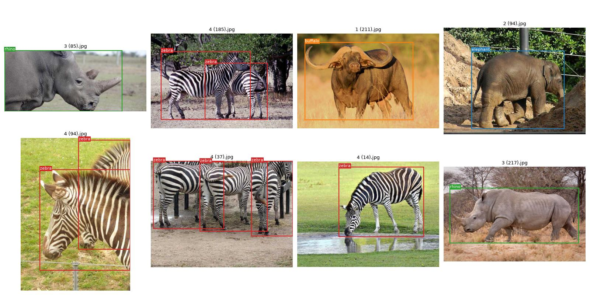
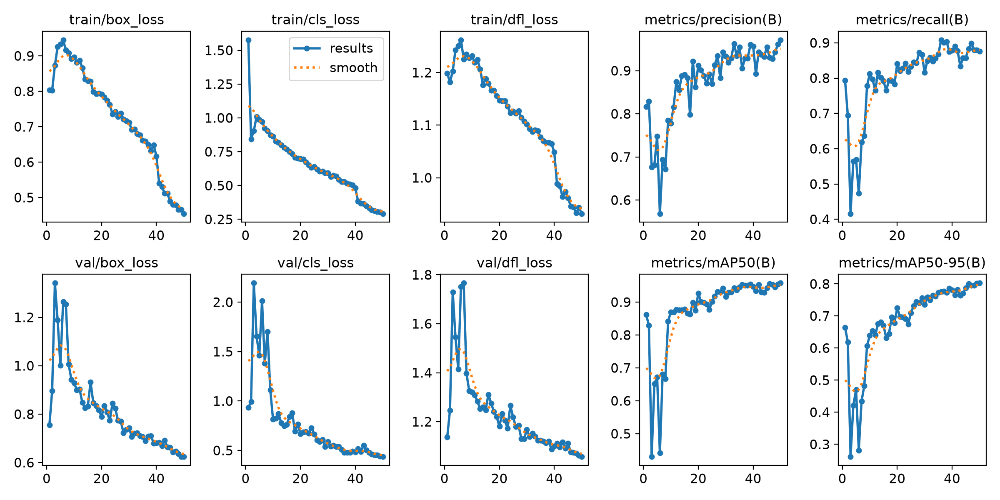
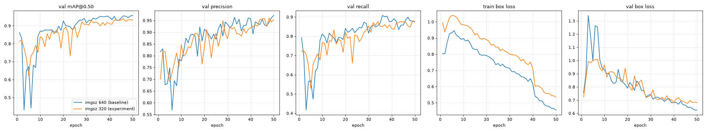
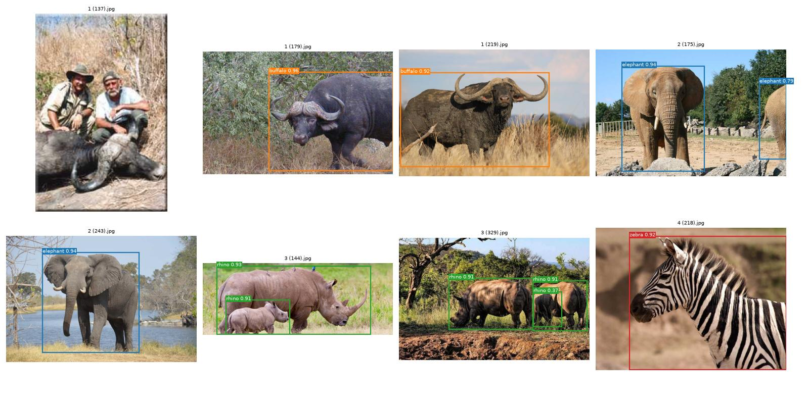
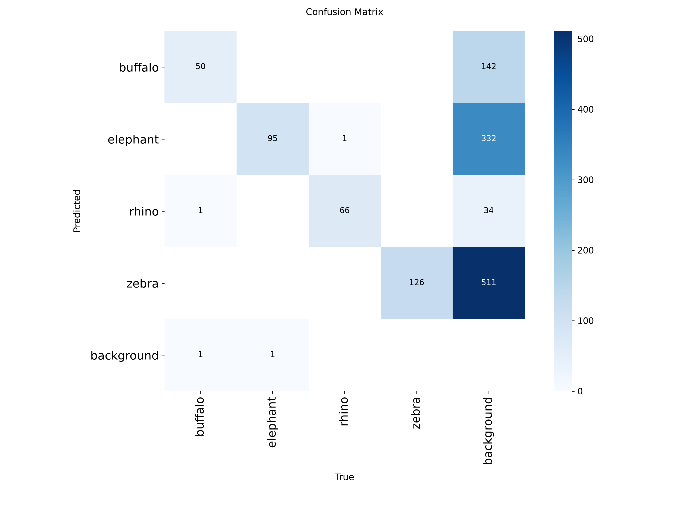
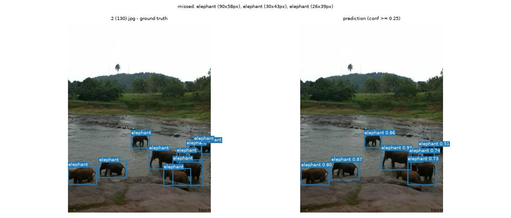
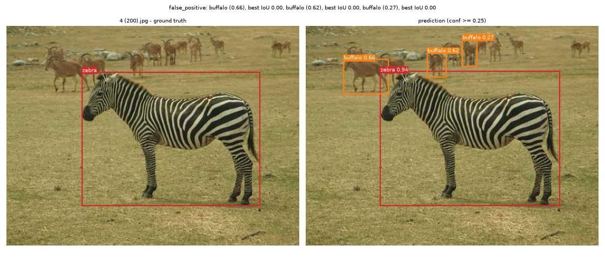
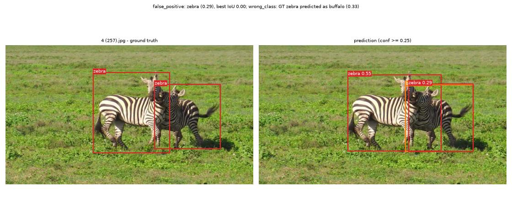

# African Wildlife Object Detection with YOLO11n

[](https://colab.research.google.com/github/sawayaka143/DL-bonus-project/blob/main/notebooks/train_and_evaluate.ipynb)

CSCI1409 Deep Learning, KBTU, bonus project: training an object detector.

**Author:** Yeskenov Aldiyar (student ID 24B031763)

## Task

Detect and classify four African animals (**buffalo, elephant, rhino, zebra**) with bounding boxes.
We fine-tune a COCO-pretrained **YOLO11n** detector (Ultralytics) and run one controlled experiment:
**input image size 640 (baseline) vs 320**, with everything else fixed.

## Repository layout

| Path | What it is |
|---|---|
| `notebooks/train_and_evaluate.ipynb` | Colab notebook: install, data, training, evaluation, predictions (fresh runtime) |
| `configs/african-wildlife.yaml` | dataset config (paths, class names) |
| `scripts/download_data.py` | downloads the dataset |
| `scripts/make_clean_split.py` | removes cross-split near-duplicates (see [Data splits](#data-splits)) |
| `scripts/data_check.py` | statistics, label checks, duplicate check, ground-truth previews |
| `scripts/train.py` | training with all hyper-parameters fixed in one place |
| `scripts/evaluate.py` | val comparison, model selection, test evaluation, prediction images, failure mining |
| `requirements.txt` | pinned dependency versions |
| `runs/baseline_640/`, `runs/exp_320/` | training outputs of both runs: `args.yaml` (full config), `results.csv` (per-epoch log), learning curves, `summary.json`, train log |
| `results/` | data checks, comparison table, test metrics, prediction examples, failure cases |

## Dataset

| | |
|---|---|
| Name | African Wildlife (Ultralytics) |
| Source | <https://docs.ultralytics.com/datasets/detect/african-wildlife>, archive: <https://github.com/ultralytics/assets/releases/download/v0.0.0/african-wildlife.zip> |
| Usage terms | Distributed by Ultralytics under the **AGPL-3.0** license; used here for non-commercial educational purposes |
| Classes | `0 buffalo`, `1 elephant`, `2 rhino`, `3 zebra` |
| Annotation format | YOLO txt: one line per object, `class x_center y_center width height`, normalised to [0, 1] |
| Images | JPEG photos, mostly one to several animals per image |

### Data splits

The official split has 1052 / 225 / 227 train / val / test images. Our duplicate check showed that it is **not
leakage-free**: 32 pairs of identical or near-identical photos were spread across splits (21 train/test,
9 train/val, 2 val/test), e.g. `train/1 (151).jpg` is the same photo as `test/1 (103).jpg`.

We fixed this deterministically in `scripts/make_clean_split.py`:

1. compute a 64-bit perceptual hash (pHash) of every image;
2. link two images if the Hamming distance is ≤ 6 and take connected components as duplicate groups;
3. move each group that spans several splits completely to the highest-priority split it touches
   (train > val > test), so leaked copies leave val/test and no image is ever moved *into* an evaluation split.

No randomness is involved, so no seed is needed. 29 images were moved (20 test → train, 8 val → train,
1 test → val); the full list is in [`results/data/split_changes.txt`](results/data/split_changes.txt).
After the fix there are **no near-duplicate pairs across splits** (duplicates inside one split remain, which is allowed).

Final split (cleaned), images / objects:

| Split | Images | Objects | buffalo | elephant | rhino | zebra |
|---|---|---|---|---|---|---|
| train | 1080 | 1978 | 416 | 565 | 410 | 587 |
| val | 218 | 366 | 86 | 87 | 82 | 111 |
| test | 206 | 341 | 52 | 96 | 67 | 126 |

### Label checks

`scripts/data_check.py` checks every label file for missing or empty files, wrong column counts, invalid
class ids, coordinates outside [0, 1], tiny boxes and duplicated boxes. **No issues were found** in any split
([`results/data/clean/label_issues.txt`](results/data/clean/label_issues.txt)). We also inspected
ground-truth previews visually; boxes are tight and correctly classed. One consistent annotation choice is worth knowing: animals
cut off by the image border, or heavily occluded in a herd, are sometimes labelled and sometimes not,
which matters for the failure analysis below.

Ground-truth examples (training set, random sample with seed 0):



## Setup and how to run

### Google Colab (recommended)

Open the notebook with the badge above, choose **Runtime → Change runtime type → T4 GPU**, and **Run all**.
It clones this repo, installs `requirements.txt`, downloads and cleans the data, trains both runs, evaluates
and shows the predictions. Set `TRAIN = False` in the training cell to skip training and download our
checkpoints instead.

### Locally

```bash
git clone https://github.com/sawayaka143/DL-bonus-project.git
cd DL-bonus-project
python -m venv .venv && source .venv/bin/activate   # Windows: .venv\Scripts\activate
pip install torch==2.11.0 torchvision==0.26.0 --index-url https://download.pytorch.org/whl/cu128
pip install -r requirements.txt
python scripts/download_data.py
python scripts/make_clean_split.py
python scripts/data_check.py
python scripts/train.py --name baseline_640 --imgsz 640
python scripts/train.py --name exp_320 --imgsz 320
python scripts/evaluate.py
```

## Baseline training

We fine-tune the COCO-pretrained YOLO11n on the cleaned training split. Every setting lives in one `FIXED`
dict in [`scripts/train.py`](scripts/train.py); the full resolved configuration Ultralytics used is saved as
[`runs/baseline_640/args.yaml`](runs/baseline_640/args.yaml).

| Setting | Value |
|---|---|
| Framework | Ultralytics **8.4.216**, PyTorch 2.11.0 + CUDA 12.8, Python 3.14 |
| Model / initial weights | YOLO11n (2.6 M parameters, 6.4 GFLOPs) / `yolo11n.pt` (COCO-pretrained) |
| Image size | **640** |
| Batch size | 16 |
| Epochs | 50 (no early stopping) |
| Optimizer / learning rate | SGD, lr0 = 0.01 linearly decayed to 0.01 × lr0, momentum 0.937, weight decay 5e-4, 3 warm-up epochs |
| Augmentation | Ultralytics defaults: mosaic (off for the last 10 epochs), random scale/translate, HSV jitter, horizontal flip |
| Random seed | 0 (`deterministic=True`) |
| Hardware | NVIDIA RTX 5060 Laptop GPU (8 GB), local |
| Training time | **9.0 min** |
| Checkpoint selection | `best.pt` = epoch with the highest **validation** fitness (Ultralytics 8.4: mAP@0.50:0.95); here epoch 50 |

Saved evidence in [`runs/baseline_640/`](runs/baseline_640): `results.csv` (per-epoch losses, val P/R/mAP, learning rates),
`train.log` (console log), `results.png` (learning curves), PR/F1 curves, confusion matrix, training-batch mosaics
and validation predictions.



Reading the curves: validation mAP drops in epochs 3–6 (the warm-up ramps the learning rate up and briefly
disturbs the pretrained weights), then recovers and plateaus around epoch 35. The visible step down in training loss
at epoch 40 is where mosaic augmentation switches off (`close_mosaic=10`) and the training images become
"easier". Validation loss keeps decreasing to the end, so 50 epochs do not overfit.

## Controlled experiment: image size 640 → 320

**Change:** `imgsz` 640 → **320** (`python scripts/train.py --name exp_320 --imgsz 320`). The data split,
initial checkpoint `yolo11n.pt`, epochs, batch size, optimizer, learning rate, augmentation and seed are identical.

**Hypothesis (stated before training):** halving the input resolution cuts computation about 4× per image,
so training is faster, but animals that are already small in the photo shrink to a few pixels and lose detail
(horns, stripes, trunk). We therefore expect **lower recall, mainly on small objects, and lower
mAP@0.50**, with a smaller effect on large, close-up animals, which dominate this dataset.

**Results on the validation set** (checkpoint `best.pt` of each run, NMS conf 0.001, NMS IoU 0.7, match IoU 0.5):

| Run | Changed setting | Val precision | Val recall | Val mAP@0.50 | Val mAP@0.50:0.95 | Train time |
|---|---|---|---|---|---|---|
| baseline_640 | imgsz = 640 | **0.972** | **0.879** | **0.959** | **0.801** | 9.0 min |
| exp_320 | imgsz = 320 | 0.951 | 0.872 | 0.932 | 0.765 | **5.6 min** |

Per-class val mAP@0.50 (640 → 320): buffalo 0.953 → 0.946, elephant 0.952 → 0.903, rhino 0.982 → 0.948, zebra 0.949 → 0.931.

Validation recall by object size (predictions with conf ≥ 0.25, IoU ≥ 0.5; size = box side as a fraction of the image side):

| Run | small (< 10 %) | medium (10–30 %) | large (> 30 %) |
|---|---|---|---|
| baseline_640 | 0.500 (n = 8) | 0.842 (n = 95) | 0.947 (n = 263) |
| exp_320 | 0.250 (n = 8) | 0.821 (n = 95) | 0.935 (n = 263) |



**Interpretation.** The hypothesis is supported. With 320 px, mAP@0.50 drops by 2.7 points and the stricter
mAP@0.50:0.95 by 3.6 points: lower resolution hurts box *localisation* more than detection itself, because one
cell of the feature map now covers twice as much of the image. The loss in recall grows as objects get smaller:
−1 point for large animals, −2 for medium, and half of the (only 8) small animals are lost; with
n = 8 that last number is noisy. Elephants lose the most (−4.9 mAP@0.50): many elephant images are distant herds in
which individual animals are small and overlapping. In return the 320 run trains **38 % faster** (5.6 vs 9.0 min)
and inference is faster (0.7 vs 1.2 ms per image on our GPU, from the final validation in `train.log`). The gap is modest because most objects here are large, close-up animals
that are still recognisable at 320 px. The 320 run also has a higher training loss
throughout: it is not overfitting, it simply has less information to fit.

**Selection:** based on validation mAP@0.50 we choose **baseline_640** as the final model. The test set was not
used for this decision.

## Final test results

The selected checkpoint (`runs/baseline_640/weights/best.pt`) was evaluated **once** on the held-out test split
(206 images, 341 objects) with [`scripts/evaluate.py`](scripts/evaluate.py).

Evaluation settings: image size 640, NMS confidence threshold **0.001**, NMS IoU threshold **0.7**, and a
prediction counts as correct when IoU ≥ **0.5** with a ground-truth box of the same class. Precision and recall are
reported, as Ultralytics does, at the confidence threshold that maximises the F1 score on the PR curve.

| Class | Precision | Recall | mAP@0.50 |
|---|---|---|---|
| buffalo | 0.931 | 0.904 | 0.932 |
| elephant | 0.966 | 0.938 | 0.977 |
| rhino | 0.985 | 0.979 | 0.992 |
| zebra | 0.962 | 0.937 | 0.981 |
| **all** | **0.961** | **0.939** | **0.971** |

mAP@0.50:0.95 on test = 0.835. Full numbers: [`results/test_metrics.json`](results/test_metrics.json).

**What the metrics measure**
- **IoU** (intersection over union): overlap of a predicted and a true box, area(A∩B) / area(A∪B).
- **Precision** = TP / (TP + FP): of all boxes the model outputs, the fraction that are correct. Low precision means false alarms.
- **Recall** = TP / (TP + FN): of all real animals, the fraction the model finds. Low recall means missed animals.
- **mAP@0.50**: for each class, sort predictions by confidence, compute the precision–recall curve with IoU ≥ 0.5
  as the matching rule, take the area under it (AP), then average over the 4 classes. It summarises
  performance over *all* confidence thresholds. mAP@0.50:0.95 averages AP over IoU thresholds 0.50…0.95, so it also rewards tight boxes.

Test predictions (random sample, seed 0, confidence ≥ 0.25):





The test mAP@0.50 (0.971) is slightly higher than validation (0.959). This is within the normal variation of
~200-image splits, and the test split has a different class mix (more zebras, fewer buffalo).

## Failure analysis

We matched every prediction (confidence ≥ 0.25) to the ground truth of all 206 test images. 32 images
contain at least one error: **11 missed objects, 28 false detections, 2 wrong classes, 3 poorly localised boxes**
(full list: [`results/failures/failures.json`](results/failures/failures.json)). Left: ground truth, right: prediction.

**1. Missed objects: small, overlapping elephants in a herd** (`2 (130).jpg`)



Three elephants are missed: two are only ~30×40 px and stand behind other elephants in the water. *Likely
cause:* small objects plus heavy occlusion. Overlapping boxes of the same class suppress each other in NMS,
and at this scale each animal covers only a few cells of the feature map. The size analysis above shows
the same pattern: recall is lowest on small objects.

**2. False detections: animals outside the 4 classes** (`4 (200).jpg`)



The zebra is found correctly (0.94), but three horned, goat-like animals in the background (not one of the 4 classes) are detected as
**buffalo** (0.66, 0.62, 0.27). *Likely cause:* the detector is closed-set. It has only seen 4 animal classes, and
the training set contains almost no other brown, horned, four-legged animals left unlabelled as background, so
anything buffalo-like is mapped to the nearest class.

**3. Wrong class / duplicate box under occlusion** (`4 (257).jpg`)



Two zebras overlap. The front zebra is found (0.55), but the rear one gets a low-confidence zebra box (0.29)
and an almost identical **buffalo** box (0.33). *Likely cause:* when animals overlap, the visible parts are
fragmented and the classifier's evidence is split between classes. NMS here is class-aware, so a zebra box and
a buffalo box on the same animal do not suppress each other.

**Other patterns seen:** inaccurate boxes in a dense buffalo herd (`1 (376).jpg`, IoU 0.34–0.47: one box
covers two animals, [failure_4](results/failures/failure_4.jpg)), and "false" elephant detections on partially visible animals at the image border that the
annotators did not label (`2 (115).jpg`, [failure_5](results/failures/failure_5.jpg)). Some false positives
are therefore annotation gaps rather than model errors, which slightly lowers measured precision.

**Practical next step:** add **hard negative images** (other savanna animals such as antelope, goats, wildebeest and
hippos, with empty label files) and more crowded-herd images to the training set. This directly targets failure 2
and the most frequent error type (28 false detections). For crowded-herd misses, a larger image size (e.g. 960)
or tiled inference would be the next experiment.

## Trained weights

Checkpoints are attached to the GitHub release [v1.0](https://github.com/sawayaka143/DL-bonus-project/releases/tag/v1.0):

| File | Description |
|---|---|
| [`baseline_640_best.pt`](https://github.com/sawayaka143/DL-bonus-project/releases/download/v1.0/baseline_640_best.pt) | **final model** (selected), YOLO11n, imgsz 640, 5.5 MB |
| [`exp_320_best.pt`](https://github.com/sawayaka143/DL-bonus-project/releases/download/v1.0/exp_320_best.pt) | experiment run, imgsz 320 |

```python
from ultralytics import YOLO
model = YOLO("baseline_640_best.pt")
model.predict("your_image.jpg", imgsz=640, conf=0.25, save=True)
```

## Limitations

- **Small, easy dataset.** ~1,500 mostly close-up, centred photos of 4 visually distinct animals, so the high scores
  do not transfer directly to camera-trap or drone imagery with small, distant or night-time animals.
- **Closed set.** The model has no notion of "other animal" and labels lookalikes as one of the 4 classes (failure 2).
- **Label noise.** Partially visible or heavily occluded animals are labelled inconsistently, which affects both
  training and the measured precision/recall.
- **Duplicate detection is approximate.** pHash with a fixed threshold catches identical and resized/re-encoded copies,
  but not crops or different photos of the same scene. Photos of the same individual or scene may still appear in
  different splits, since the dataset has no source/scene metadata.
- **Single seed.** Each configuration was trained once (seed 0). Differences of 1–2 mAP points between runs are
  near the run-to-run noise level; the 640 vs 320 gap (2.7 / 3.6 points) is larger and consistent in direction
  across classes and object sizes, but repeated seeds would make it firmer.
- **Small evaluation splits.** With ~200 images, a single image changes per-class metrics by about 1 point.

## Credits and use of assistance

- [Ultralytics](https://github.com/ultralytics/ultralytics) (AGPL-3.0): YOLO11 architecture, COCO-pretrained
  `yolo11n.pt` weights, training/validation code and the African Wildlife dataset. We use the library as is.
- **Our additions:** the leakage-free split (`make_clean_split.py`), data checks and visualisations
  (`data_check.py`), the fixed training configuration and controlled experiment (`train.py`), model selection,
  test evaluation and the failure-mining code that matches predictions to ground truth (`evaluate.py`),
  the Colab notebook and this report.
- AI assistance: Claude (Anthropic) was used to help write the scripts, the notebook and this README.
  All results were produced by running the code in this repository.
